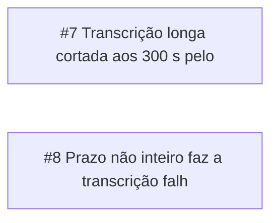

<!-- GENERATED, DO NOT EDIT: regenerado por /reversa-debugger-graph em 2026-11-25T21:19:39-03:00 a partir de 2 bugs -->

# Grafo · transcricao-de-audios

## Clusters

Os 2 bugs nascem no mesmo arquivo, `src/modules/media/infrastructure/transcribers/openai-compatible.ts`, no cálculo e no uso do prazo da chamada ao motor. Eram independentes: a relação caused-by do #8 para o #7 foi rejeitada na investigação. Corrigidos juntos na branch `fix/005-transcricao-longa`.

## Impact score

Heurística de triagem (causados*3 + bloqueados*2 + regressões*4 + relacionados*1, só arestas supported/confirmed); não substitui priority/severity.

Nenhum bug aberto.
